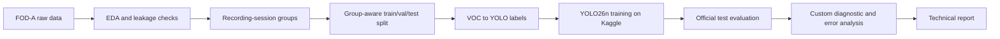
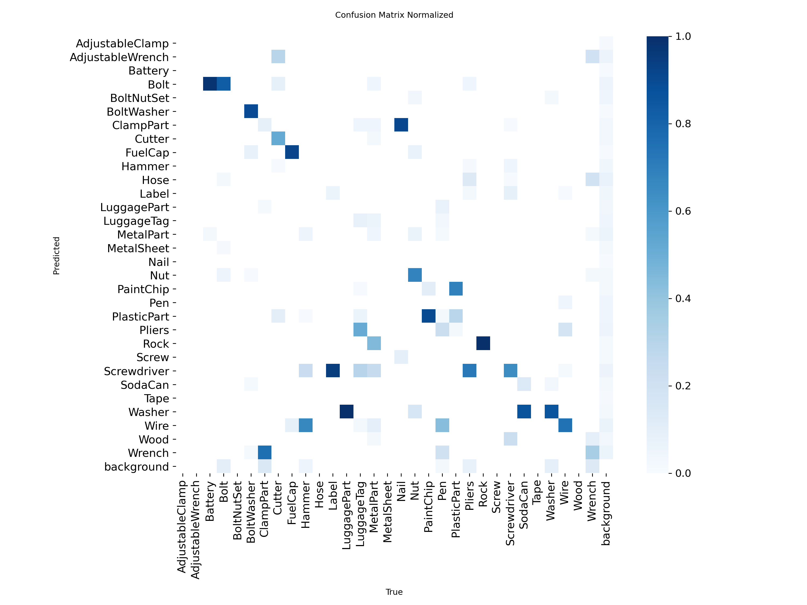
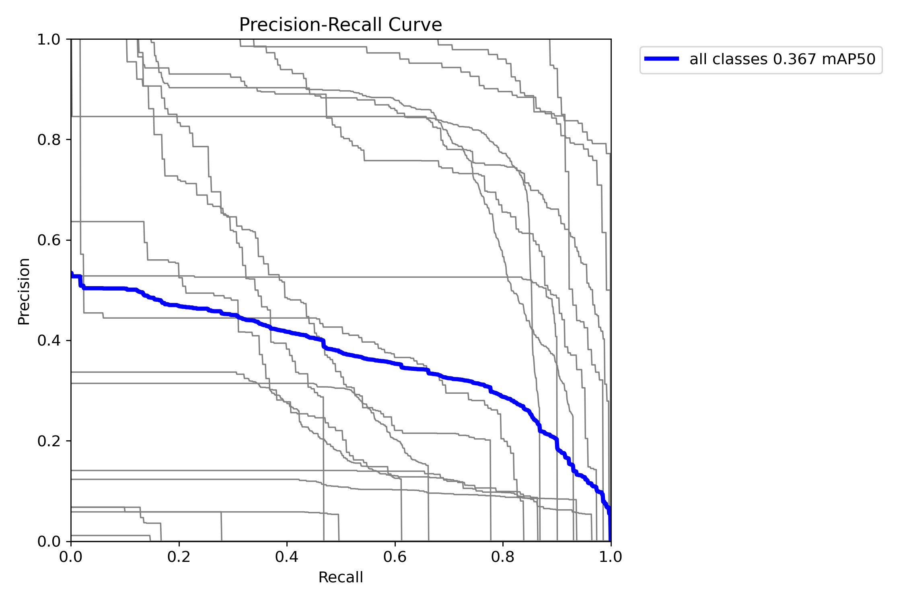
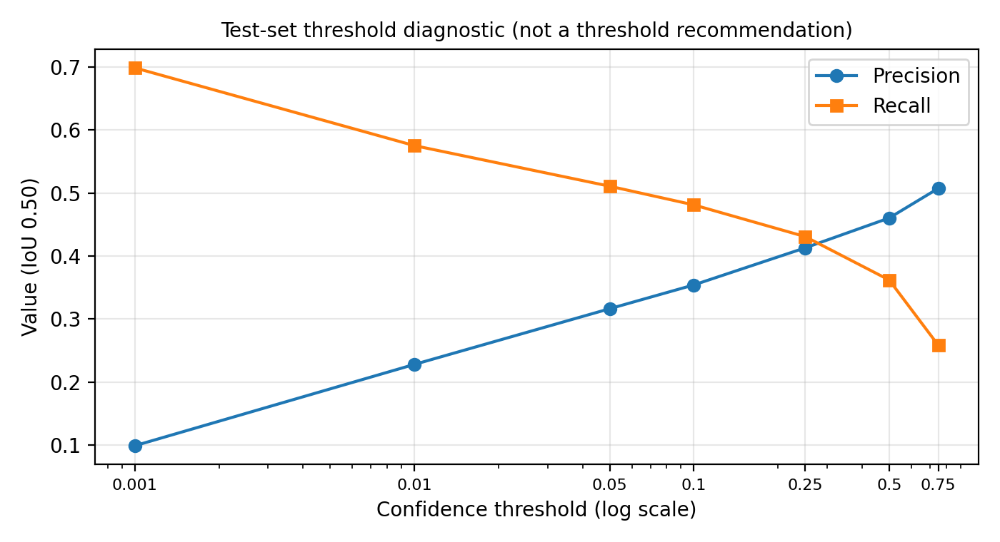
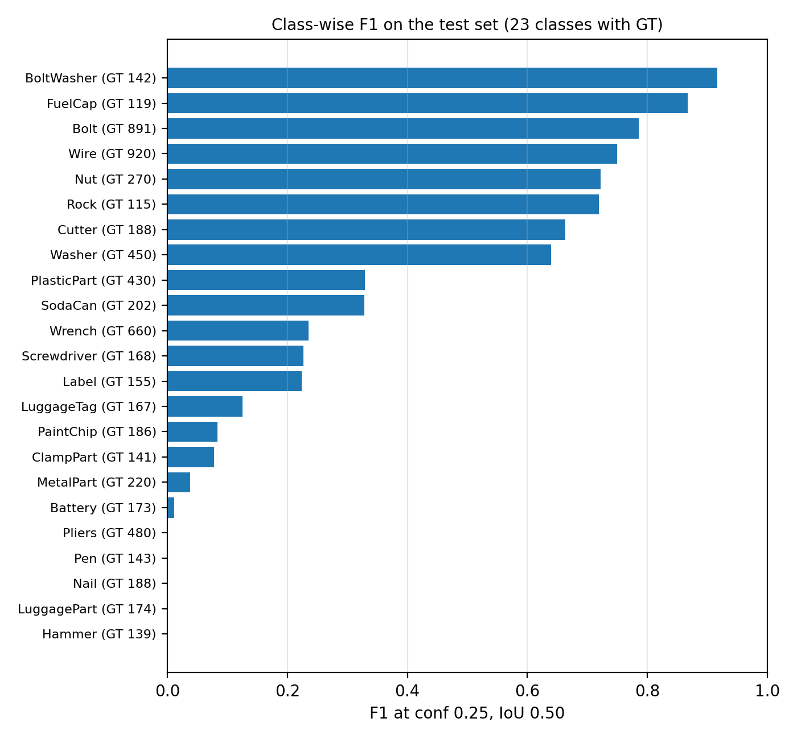

# Foreign Object Detection with YOLO26n

Detect 31 types of foreign object debris (FOD) in 300x300 images, trained with **YOLO26n** and evaluated on a **group-aware held-out test set**.

> **Status:** personal portfolio project. It is **not** a production system. No production-readiness, real-time or real UAV-deployment claim is made, and no trained model weights are published.

## Contents
[Problem](#problem) · [Objectives](#objectives) · [At a glance](#at-a-glance) · [Workflow](#workflow) · [Dataset](#dataset) · [Data preparation](#data-preparation-and-group-aware-split) · [Model](#model-and-training) · [Results](#results) · [Limitations](#limitations) · [Future work](#future-improvements) · [Reproduce](#reproduce) · [Repository layout](#repository-layout) · [Acknowledgements](#acknowledgements)

## Problem
Small objects left on airport pavement (tools, fasteners, debris) are a safety risk. Automatically spotting them in images is a hard small-object detection problem: objects are tiny, backgrounds vary with weather and light, and many categories look alike.

## Objectives
- Build a leakage-aware data pipeline (images from the same recording session must not appear in both train and test).
- Train a lightweight YOLO26n detector on 31 FOD classes.
- Report results honestly: official metrics and custom diagnostics, kept separate, with errors analysed.

## At a glance
| | |
|---|---|
| Data | 33,793 images, 31 classes (FOD-A, see [Acknowledgements](#acknowledgements)) |
| Split (group-aware) | train 23,688 / val 3,384 / test 6,721 |
| Model | YOLO26n, Ultralytics 8.4.214, Kaggle Tesla T4 |
| Training | EarlyStopping at epoch 43, best checkpoint epoch 23 |

## Workflow


## Dataset
FOD-A: 33,793 images, 31 object categories, Pascal VOC annotations (300x300 version). The dataset is **not** redistributed here; see [THIRD_PARTY_NOTICES.md](THIRD_PARTY_NOTICES.md).

## Data preparation and group-aware split
Neighbouring frames of one recording session look almost identical, so a random split would leak test information into training. The scripts in [`data_preparation/scripts/`](data_preparation/scripts/) analyse overlap, adjacency and sequences, build recording-session groups, assign whole groups to a split, convert VOC to YOLO format and validate the config with Ultralytics. See [data_preparation/README.md](data_preparation/README.md) for the stage-by-stage table.

## Model and training
YOLO26n, 100 epochs with patience 20, MuSGD optimiser, mixed precision, seed 0. Training ran in two Kaggle sessions (epochs 1-9, then a resume; batch size 49 in the resumed run). Full verified configuration and its caveats are in the [technical report](reports/FOD_Final_Technical_Report.pdf).

## Results
Two evaluations are reported. **They measure different things and are not directly comparable.**

### A. Official Ultralytics test evaluation (6,721 test images)
| Precision | Recall | mAP50 | mAP50-95 |
|---|---|---|---|
| 0.380 | 0.426 | 0.367 | 0.252 |




### B. Custom diagnostic (fixed threshold: confidence >= 0.25, IoU >= 0.50)
Greedy one-to-one, same-class matching.

| TP | FP | FN | Precision | Recall | F1 |
|---|---|---|---|---|---|
| 2,896 | 4,117 | 3,825 | 0.4129 | 0.4309 | 0.4217 |




An earlier custom evaluation used a wrong class mapping; it was found, corrected and disclosed. The corrected numbers above are authoritative. Metric files: [`evaluation/metrics/`](evaluation/metrics/). Error analysis: [`evaluation/error_analysis/`](evaluation/error_analysis/).

## Not published yet
Annotated example images, a demo video and the Kaggle notebook exist locally but are **withheld** until dataset redistribution permission is confirmed. The report refers to them.

## Limitations
- Moderate detection quality (mAP50 0.367); many classes are weak and 8 of the 31 classes have no test ground truth.
- Validation scores are optimistic because the best epoch was chosen on validation data.
- Exact arguments of the official test run were not recovered (`args.yaml` missing).
- Single dataset, 300x300 images; no field or real-hardware testing.

## Future improvements
See [improvement_roadmap.csv](evaluation/error_analysis/improvement_roadmap.csv) and the report. Examples: higher resolution input, class-balanced sampling, larger models, threshold calibration per class.

## Reproduce
Requires the FOD-A Pascal VOC data (obtain it from the authors) placed at `data/raw/FODPascalVOCFormat-V.2.1`. Run from the repository root:
```bash
pip install -r requirements.txt
python data_preparation/scripts/eda.py
```
Other stages follow the order in [data_preparation/README.md](data_preparation/README.md). Training and evaluation were run on Kaggle; the exact notebook is not published yet. Script docstrings say `python src\...`; read that as `python data_preparation/scripts/...`.

## Repository layout
```text
data_preparation/scripts/   18 Python scripts (unchanged)
evaluation/                 metrics, confusion matrix, curves, error analysis
reports/                    technical report (PDF/MD), summary, QC, figures
deployment/                 conceptual deployment note (not implemented)
THIRD_PARTY_NOTICES.md      dataset and framework attribution
```

## Acknowledgements
Dataset: **FOD-A** by Munyer, Huang, Huang and Zhong (University of Nebraska Omaha), https://github.com/FOD-UNOmaha/FOD-data. Please cite arXiv:2110.03072 and arXiv:2106.00161. Detector: Ultralytics YOLO.
