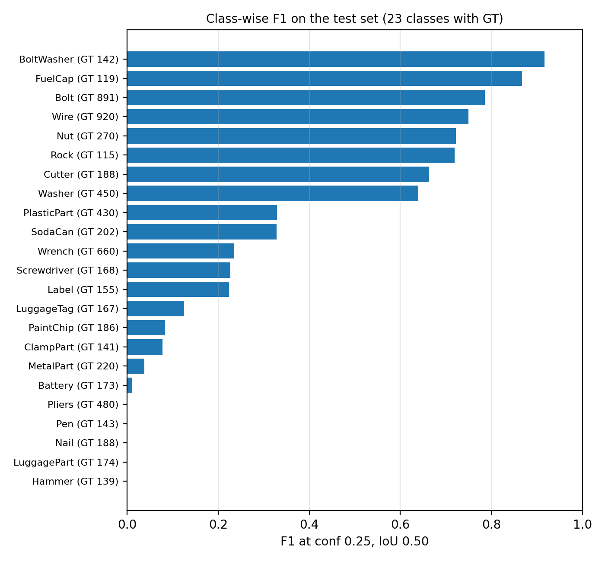
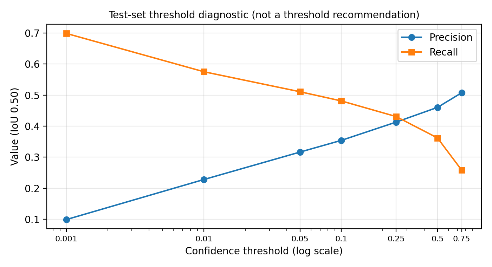

# Foreign Object Detection (FOD) with YOLO26n - Final Technical Report

Evidence labels: **[VERIFIED]** checked against source files in this report step; **[MEASURED]** produced by an earlier evaluation step; **[PROVIDED]** taken from the project record/earlier stage and not re-checked here; **[HYPOTHESIS]** plausible but unconfirmed; **[PROPOSED]** future work, not implemented or measured.

## 1. Project Objective
The goal is an object detection system that identifies Foreign Object Debris (FOD) in runway-like image environments with YOLO26n: it detects objects, predicts their class, and outputs bounding boxes and confidence scores. Performance is evaluated on a held-out test set, false positives and false negatives are analysed, and limitations and a possible UAV deployment are discussed.

**Honest scope.** This is a dataset-level FOD experiment on close-up object images. It is not an airport runway safety system and has not been validated for operational use.

## 2. Dataset Information
Dataset: `FODPascalVOCFormat-V.2.1`. Original structure [PROVIDED]: JPEGImages, Annotations (Pascal VOC XML), ImageSets/Main, CategorizationData.

| Property | Value | Status |
|---|---|---|
| Total images | 33,793 | VERIFIED (23,688 + 3,384 + 6,721 label/image files) |
| Original resolution | 300 x 300 | VERIFIED on test images; PROVIDED for the full set |
| Classes | 31 | VERIFIED (data_kaggle.yaml, nc=31) |
| Train / Val / Test images | 23,688 / 3,384 / 6,721 | VERIFIED |
| Total objects | 34,472 | VERIFIED (train 24,367 + val 3,384 + test 6,721) |

The images are close-up views of single objects on concrete/asphalt-like backgrounds [PROVIDED]. This differs from real UAV runway inspection, where objects are small within large, cluttered scenes, with altitude, motion blur, glare and shadows. Results therefore describe performance on this dataset, not on real runways.

## 3. Data Exploration and Preprocessing
Earlier stages performed image/annotation inspection, class distribution analysis, bounding-box size analysis, weather/lighting analysis, sequence/group analysis, and duplicate/missing-image checks [PROVIDED]; their detailed outputs are not re-presented here.

**Weather and lighting** [PROVIDED, Step 4b; arithmetic re-checked: 26,577 + 7,216 = 33,793 and 16,942 + 12,464 + 4,387 = 33,793].

| Condition | Images | Percentage |
|---|---|---|
| Dry | 26,577 | 78.65% |
| Wet | 7,216 | 21.35% |
| Bright | 16,942 | 50.13% |
| Dim | 12,464 | 36.88% |
| Dark | 4,387 | 12.98% |

Limitations: every Wet image is categorized as Dim, so wetness and lighting cannot be separated; fog is absent; Dark does not necessarily mean night.

**Annotation conversion** [PROVIDED]: 33,793 XML annotations processed, 33,793 image-label pairs matched, 31 classes mapped, 34,472 objects converted, 0 invalid/out-of-bounds boxes, 0 empty label files, all 10 mandatory conversion checks passed. [VERIFIED now]: 33,793 label files, 34,472 objects, 0 empty files, 0 malformed lines.

**YOLO label format.** Each image has one `.txt` file with one line per object: `class_id x_center y_center width height`
All four box values are normalized to 0-1 by image width/height. From a Pascal VOC box (xmin, ymin, xmax, ymax) on a W x H image: x_center = (xmin+xmax)/2/W, y_center = (ymin+ymax)/2/H, width = (xmax-xmin)/W, height = (ymax-ymin)/H. For these 300 x 300 images, pixel coordinates are the normalized values times 300.

**Class IDs.** Classes are mapped to IDs 0-30 in `data_kaggle.yaml` (AdjustableClamp = 0 ... Wrench = 30); the order is alphabetical [VERIFIED].

## 4. Dataset Splitting
| Split | Images | Percentage | Objects |
|---|---|---|---|
| Train | 23,688 | 70.10% | 24,367 |
| Validation | 3,384 | 10.01% | 3,384 |
| Test | 6,721 | 19.89% | 6,721 |

**Group-based splitting [PROVIDED].** Images were assigned to splits by group (assignment unit) so that images from the same group/sequence stay in one split. A random image-level split was avoided because near-identical frames of the same scene would land in both train and test, inflating test scores (leakage). Leakage prevention was applied at the assignment-unit level only.

**Verified per-class object counts per split:**

| ID | Class | Train | Val | Test |
|---|---|---|---|---|
| 0 | AdjustableClamp | 544 | 0 | 0 |
| 1 | AdjustableWrench | 472 | 0 | 0 |
| 2 | Battery | 700 | 186 | 173 |
| 3 | Bolt | 1966 | 443 | 891 |
| 4 | BoltNutSet | 514 | 0 | 0 |
| 5 | BoltWasher | 875 | 0 | 142 |
| 6 | ClampPart | 511 | 265 | 141 |
| 7 | Cutter | 1014 | 150 | 188 |
| 8 | FuelCap | 429 | 0 | 119 |
| 9 | Hammer | 451 | 170 | 139 |
| 10 | Hose | 294 | 0 | 0 |
| 11 | Label | 1030 | 125 | 155 |
| 12 | LuggagePart | 395 | 169 | 174 |
| 13 | LuggageTag | 1283 | 236 | 167 |
| 14 | MetalPart | 582 | 168 | 220 |
| 15 | MetalSheet | 394 | 0 | 0 |
| 16 | Nail | 1005 | 0 | 188 |
| 17 | Nut | 941 | 92 | 270 |
| 18 | PaintChip | 605 | 177 | 186 |
| 19 | Pen | 340 | 0 | 143 |
| 20 | PlasticPart | 1389 | 189 | 430 |
| 21 | Pliers | 2221 | 183 | 480 |
| 22 | Rock | 362 | 185 | 115 |
| 23 | Screw | 157 | 0 | 0 |
| 24 | Screwdriver | 643 | 0 | 168 |
| 25 | SodaCan | 574 | 174 | 202 |
| 26 | Tape | 127 | 0 | 0 |
| 27 | Washer | 1519 | 170 | 450 |
| 28 | Wire | 1077 | 141 | 920 |
| 29 | Wood | 206 | 0 | 0 |
| 30 | Wrench | 1747 | 161 | 660 |

Verified consequences:
- Eight classes (AdjustableClamp, AdjustableWrench, BoltNutSet, Hose, MetalSheet, Screw, Tape, Wood) are train-only: zero validation and zero test objects.
- Thirteen classes have zero validation objects: AdjustableClamp, AdjustableWrench, BoltNutSet, BoltWasher, FuelCap, Hose, MetalSheet, Nail, Pen, Screw, Screwdriver, Tape, Wood. Validation metrics can therefore reflect only 18 classes, whereas the test set contains 23 classes.
- Validation and test contain exactly one object per image (objects = images, no empty label files); the training set has 24,367 objects in 23,688 images.
- Rare-class and zero-GT limitations mean some class-level metrics are unavailable or statistically weak.
- **A cross-split neighbouring-frame leakage audit was deferred and not run. Complete temporal leakage elimination is NOT claimed.**

## 5. Model Selection
YOLO26n (Ultralytics 8.4.214) with pretrained COCO weights was fine-tuned for 31 target classes. A lightweight detector was chosen because of limited compute (Kaggle T4), the need for practical inference, small model size, and suitability for experimentation. YOLO26n is not proven optimal for this dataset; no other architectures were compared.

## 6. Training Configuration
Executed settings below come from the saved `args.yaml` of the resumed run (and the original checkpoint `args.yaml` where different) [VERIFIED].

| Setting | Value | Status |
|---|---|---|
| Platform / GPU | Kaggle, NVIDIA Tesla T4 (GPU 0) | PROVIDED; device=0 in args.yaml |
| Model / pretrained | yolo26n.pt / pretrained=True | VERIFIED |
| Epochs / patience | 100 / 20 | VERIFIED (configured) |
| Image size | 640 | VERIFIED (configured) |
| Batch size | 49 (original run: -1 = AutoBatch) | VERIFIED (resumed run) |
| Optimizer | MuSGD (original run: auto) | VERIFIED (args) |
| lr0 | 0.01 | VERIFIED |
| Momentum | args.yaml: 0.937; project record: 0.9 | DISCREPANCY - executed value not independently verified |
| Workers | 4 | VERIFIED |
| Mixed precision / seed / deterministic | True / 0 / True | VERIFIED |
| Mosaic / close_mosaic | 1.0 / last 10 epochs | VERIFIED (configured) |
| HSV (h, s, v) | 0.015, 0.7, 0.4 | VERIFIED (configured) |
| Rotation / translate / scale / shear / perspective | 10 / 0.1 / 0.5 / 0.0 / 0.0 | VERIFIED (configured) |
| Flip (up / left-right) | 0.0 / 0.5 | VERIFIED (configured) |
| Mixup / copy_paste / cls_remap | 0.0 / 0.0 / True | VERIFIED (configured) |

Training ran in two sessions: epochs 1-9 in the first, then a resume from the last checkpoint. `results.csv` of the resumed run records 43 epochs. EarlyStopping ended training at epoch 43 [PROVIDED log; consistent with patience 20 and best epoch 23]. Duration for the resumed portion (epochs 10-43) was approximately 2.410 hours [PROVIDED]. results.csv time column cross-check (epoch 9 to 43): 1.716 h (does NOT match the provided value; treat 2.410 h as unverified).

## 7. Validation Results
Best checkpoint (epoch 23) [VERIFIED from results.csv]:

| Metric | Epoch 23 (best) | Epoch 43 (last) |
|---|---|---|
| Precision | 0.558 | 0.568 |
| Recall | 0.473 | 0.487 |
| mAP50 | 0.477 | 0.441 |
| mAP50-95 | 0.393 | 0.374 |

**EarlyStopping.** Training monitors a validation fitness score and stops if it does not improve for `patience` = 20 epochs. The best fitness occurred at epoch 23 (best-epoch check used the default fitness weighting, assumed), so training stopped at epoch 43 (23 + 20) and `best.pt` holds epoch 23. The best epoch was chosen on validation data, which makes validation scores optimistic.

## 8. Held-Out Test Results
Official Step 13 evaluation on the 6,721 test images (first use of the test set) [MEASURED]. The exact confidence/IoU arguments of this evaluation were **not recovered because `args.yaml` was missing**, and the numbers come from the evaluation console output rather than a saved results file.

| Metric | Validation (epoch 23) | Official test | Absolute gap | Relative gap |
|---|---|---|---|---|
| Precision | 0.558 | 0.380 | 0.178 | 31.9% |
| Recall | 0.473 | 0.426 | 0.047 | 9.9% |
| mAP50 | 0.477 | 0.367 | 0.110 | 23.1% |
| mAP50-95 | 0.393 | 0.252 | 0.141 | 35.9% |

**The gap does not alone prove overfitting.** (a) The best epoch was selected on validation, biasing it upward. (b) Validation covers only 18 classes with objects, the test set 23, so the class sets differ. (c) The official test arguments are unrecovered. (d) Split distributions may differ. Separating overfitting from split differences would need train/val/test comparison on identical classes and metrics.

## 9. Corrected TP / FP / FN Analysis
A custom, threshold-specific analysis was run on the test set: confidence >= 0.25, IoU >= 0.50, greedy one-to-one, same-class matching, with `YOLO class ID = category_id - 1` (verified in the Ultralytics 8.4.214 source: the JSON export uses `class_map = range(1, nc+1)` for non-COCO datasets). An earlier version of this analysis treated category IDs as zero-based; that error was found and corrected, and its results were discarded and are not used here.

| Metric | Value |
|---|---|
| Images processed | 6,721 |
| Ground-truth objects | 6,721 |
| Source predictions | 47,592 |
| Predictions retained (conf >= 0.25) | 7,013 |
| True Positives (TP) | 2,896 |
| False Positives (FP) | 4,117 |
| False Negatives (FN) | 3,825 |
| Precision | 0.4129 |
| Recall | 0.4309 |
| F1 | 0.4217 |

These are **fixed-threshold metrics** and are not directly comparable to the official Step 13 values (mAP integrates over all confidence levels; the official P/R arguments are unrecovered).

- **TP:** a prediction with confidence >= 0.25 and the correct class that overlaps an unmatched ground-truth box with IoU >= 0.50.
- **FP:** a retained prediction that matches no such ground-truth object (wrong class, poor localization, duplicate, or no object).
- **FN:** a ground-truth object that no qualifying prediction matches.
- **Precision** = TP / (TP + FP): how many retained detections are correct. **Recall** = TP / (TP + FN): how many real objects are found. **F1** = 2PR / (P + R).

## 10. Class-wise Performance
Source: `step14b_corrected/classwise_metrics.csv` (F1 computed from it). Eight classes have zero test GT; their rows show only predictions (all FP) and carry **no performance conclusion**.

| ID | Class | GT | Pred | TP | FP | FN | Precision | Recall | F1 |
|---|---|---|---|---|---|---|---|---|---|
| 0 | AdjustableClamp | 0 | 2 | 0 | 2 | 0 | 0.0 | 0.0 | 0.0 |
| 1 | AdjustableWrench | 0 | 248 | 0 | 248 | 0 | 0.0 | 0.0 | 0.0 |
| 2 | Battery | 173 | 1 | 1 | 0 | 172 | 1.0 | 0.0058 | 0.0115 |
| 3 | Bolt | 891 | 947 | 722 | 225 | 169 | 0.7624 | 0.8103 | 0.7856 |
| 4 | BoltNutSet | 0 | 19 | 0 | 19 | 0 | 0.0 | 0.0 | 0.0 |
| 5 | BoltWasher | 142 | 133 | 126 | 7 | 16 | 0.9474 | 0.8873 | 0.9164 |
| 6 | ClampPart | 141 | 219 | 14 | 205 | 127 | 0.0639 | 0.0993 | 0.0778 |
| 7 | Cutter | 188 | 150 | 112 | 38 | 76 | 0.7467 | 0.5957 | 0.6627 |
| 8 | FuelCap | 119 | 130 | 108 | 22 | 11 | 0.8308 | 0.9076 | 0.8675 |
| 9 | Hammer | 139 | 12 | 0 | 12 | 139 | 0.0 | 0.0 | 0.0 |
| 10 | Hose | 0 | 239 | 0 | 239 | 0 | 0.0 | 0.0 | 0.0 |
| 11 | Label | 155 | 42 | 22 | 20 | 133 | 0.5238 | 0.1419 | 0.2234 |
| 12 | LuggagePart | 174 | 8 | 0 | 8 | 174 | 0.0 | 0.0 | 0.0 |
| 13 | LuggageTag | 167 | 41 | 13 | 28 | 154 | 0.3171 | 0.0778 | 0.125 |
| 14 | MetalPart | 220 | 148 | 7 | 141 | 213 | 0.0473 | 0.0318 | 0.038 |
| 15 | MetalSheet | 0 | 5 | 0 | 5 | 0 | 0.0 | 0.0 | 0.0 |
| 16 | Nail | 188 | 5 | 0 | 5 | 188 | 0.0 | 0.0 | 0.0 |
| 17 | Nut | 270 | 204 | 171 | 33 | 99 | 0.8382 | 0.6333 | 0.7215 |
| 18 | PaintChip | 186 | 343 | 22 | 321 | 164 | 0.0641 | 0.1183 | 0.0832 |
| 19 | Pen | 143 | 119 | 0 | 119 | 143 | 0.0 | 0.0 | 0.0 |
| 20 | PlasticPart | 430 | 505 | 154 | 351 | 276 | 0.305 | 0.3581 | 0.3294 |
| 21 | Pliers | 480 | 282 | 0 | 282 | 480 | 0.0 | 0.0 | 0.0 |
| 22 | Rock | 115 | 205 | 115 | 90 | 0 | 0.561 | 1.0 | 0.7188 |
| 23 | Screw | 0 | 44 | 0 | 44 | 0 | 0.0 | 0.0 | 0.0 |
| 24 | Screwdriver | 168 | 769 | 106 | 663 | 62 | 0.1378 | 0.631 | 0.2263 |
| 25 | SodaCan | 202 | 60 | 43 | 17 | 159 | 0.7167 | 0.2129 | 0.3282 |
| 26 | Tape | 0 | 0 | 0 | 0 | 0 | 0.0 | 0.0 | 0.0 |
| 27 | Washer | 450 | 770 | 390 | 380 | 60 | 0.5065 | 0.8667 | 0.6393 |
| 28 | Wire | 920 | 770 | 633 | 137 | 287 | 0.8221 | 0.688 | 0.7491 |
| 29 | Wood | 0 | 86 | 0 | 86 | 0 | 0.0 | 0.0 | 0.0 |
| 30 | Wrench | 660 | 507 | 137 | 370 | 523 | 0.2702 | 0.2076 | 0.2348 |

- **Strong (F1 >= 0.65, descriptive rule):** Bolt, BoltWasher, Cutter, FuelCap, Nut, Rock, Wire (Cutter qualifies by this rule in addition to the six highlighted in the project notes).
- **Weak (TP > 0, F1 < 0.30):** Battery, ClampPart, Label, LuggageTag, MetalPart, PaintChip, Screwdriver, Wrench.
- **Zero TP with GT > 0:** Hammer, LuggagePart, Nail, Pen, Pliers.
- **No test GT (no conclusion possible):** AdjustableClamp, AdjustableWrench, BoltNutSet, Hose, MetalSheet, Screw, Tape, Wood. Predictions on them are false positives by construction; this does not prove the model can never detect them.
- **Low-sample caveat:** classes have between 115 and 920 test objects; no confidence intervals were computed, so small differences between classes should not be over-read.
- **Verified observations [HYPOTHESES about causes]:** BoltWasher and FuelCap have zero validation objects yet are strong on test; Nail and Pen (zero validation objects) have zero TP; Screwdriver (zero validation objects) is weak. Pliers has the most training objects (2,221) yet zero TP, and Wrench has 1,747 training objects with weak test results, so low training count alone does not explain weak classes.

## 11. Visual Evidence
Fifteen annotated examples (4 TP, 4 FP, 4 FN, 3 mixed) were generated at 900 x 900 from the original 300 x 300 images using exact 3x nearest-neighbour scaling (green = ground truth, red = prediction). Source: `step14c_visual_evidence/visual_evidence_index.csv`.

| Image | Type | GT class | Predicted | Conf | IoU | Image TP/FP/FN |
|---|---|---|---|---|---|---|
| 011992.jpg | TP | Bolt | Bolt | 0.846 | 0.906 | 1/0/0 |
| 011517.jpg | TP | FuelCap | FuelCap | 0.924 | 0.813 | 1/0/0 |
| 028364.jpg | TP | Rock | Rock | 0.918 | 0.853 | 1/0/0 |
| 001415.jpg | TP | BoltWasher | BoltWasher | 0.821 | 0.774 | 1/0/0 |
| 017985.jpg | FP | Pliers | Screwdriver | 0.916 | N/A | 0/1/1 |
| 004563.jpg | FP | PlasticPart | PaintChip | 0.914 | N/A | 0/1/1 |
| 024922.jpg | FP | Pen | Wrench | 0.795 | N/A | 0/1/1 |
| 012689.jpg | FP | Bolt | AdjustableWrench | 0.800 | N/A | 1/1/0 |
| 017872.jpg | FN | Pliers | N/A (unmatched GT) | N/A | N/A | 0/1/1 |
| 018701.jpg | FN | Wrench | N/A (unmatched GT) | N/A | N/A | 0/2/1 |
| 019176.jpg | FN | Hammer | N/A (unmatched GT) | N/A | N/A | 0/1/1 |
| 024416.jpg | FN | PaintChip | N/A (unmatched GT) | N/A | N/A | 0/1/1 |
| 018325.jpg | MIX | Wrench | AdjustableWrench 0.355 [FP]; Wrench 0.295 [TP] | see predicted_class | N/A | 1/1/0 |
| 021498.jpg | MIX | ClampPart | Wrench 0.799 [FP]; Wrench 0.717 [FP]; Wrench 0.597 [FP] | see predicted_class | N/A | 0/3/1 |
| 024271.jpg | MIX | PaintChip | PlasticPart 0.914 [FP] | see predicted_class | N/A | 0/1/1 |

**Critical limitation: human visual inspection was NOT completed.** The annotated images were generated programmatically. All observations are computed from coordinates, class IDs, confidence and IoU; **no failure cause has been visually confirmed** and class confusion is a hypothesis. The 15 hand-picked examples do not prove general model behaviour. Image 012689 is an FP example, but its image-level counts are TP=1, FP=1, FN=0.

## 12. Error Analysis
- Both error types are large: FN = 3825 (56.9% of GT missed) and FP = 4117 (58.7% of retained predictions).
- Five zero-TP classes hold 1124 GT objects and account for 29.4% of all FN.
- The eight classes with zero test GT account for 643 FP predictions.
- **Hypotheses (visual confirmation pending):** possible class confusion between Pliers / Screwdriver, PaintChip / PlasticPart, and Wrench / AdjustableWrench, based on boxes that overlap strongly (IoU 0.83 to 0.97) with a different predicted class in the approved examples.
- **Small objects:** the ~9.3 x 7.7 px BoltWasher example was detected (conf 0.821, IoU 0.774) while larger objects (e.g. Hammer ~271 x 230 px) were missed, so small size alone is not established as the primary failure cause. Illustrative arithmetic: a perfect box shifted 2 px diagonally has IoU 0.41 for a 9.3 x 7.7 object but 0.86 for 49.9 x 57.2.
- **Threshold diagnostic (test set, understanding only; not a threshold recommendation):**

| Conf threshold | TP | FP | FN | Precision | Recall |
|---|---|---|---|---|---|
| 0.001 | 4697 | 42895 | 2024 | 0.0987 | 0.6989 |
| 0.01 | 3867 | 13112 | 2854 | 0.2278 | 0.5754 |
| 0.05 | 3434 | 7423 | 3287 | 0.3163 | 0.5109 |
| 0.1 | 3234 | 5899 | 3487 | 0.3541 | 0.4812 |
| 0.25 | 2896 | 4117 | 3825 | 0.4129 | 0.4309 |
| 0.5 | 2432 | 2850 | 4289 | 0.4604 | 0.3619 |
| 0.75 | 1734 | 1682 | 4987 | 0.5076 | 0.258 |

Lowering the threshold raises recall and lowers precision; no production threshold is recommended, and any threshold must be chosen on validation data, not test data.

## 13. Improvement Roadmap (proposed, not yet measured)
**Priority 1: Class-level data/label audit and rebalancing for zero-TP and confusable classes**
- Problem: 5 zero-TP classes (1124 GT, 16.7% of test GT); Pliers/Screwdriver, PaintChip/PlasticPart, Wrench/AdjustableWrench overlap pattern (hypothesis)
- Proposed experiment: Count per-class training instances; review annotations and class definitions for confusable pairs; add varied examples or class-aware sampling; retrain on same splits with otherwise identical settings
- Expected benefit: Hypothesis only: higher recall/precision on targeted classes; NOT measured
- Trade-off: Labels may be intrinsically ambiguous; rebalancing may reduce strong-class performance; more near-duplicate frames add little diversity
- Evaluation metric: Per-class recall/precision/F1 and mAP50 on validation for target classes; confusion off-diagonals for the pairs; no regression on strong classes; one final test evaluation

**Priority 2: Validation-based per-class threshold calibration and stronger evaluation protocol**
- Problem: Single threshold 0.25; test recall/precision trade-off (P 0.0987/R 0.6989 at 0.001 vs P 0.5076/R 0.258 at 0.75); official eval arguments unrecovered
- Proposed experiment: Save all eval arguments; per-class PR curves on validation; choose operating points for an explicit recall target; freeze; evaluate once on test with bootstrap confidence intervals and report FP per image
- Expected benefit: Hypothesis only: transparent safety-oriented operating points; possibly higher recall at an acceptable alert load; NOT measured
- Trade-off: Small per-class validation counts; thresholds may not transfer to test or real UAV data; leakage if tuned on test
- Evaluation metric: Target recall met on held-out test with reported FP-per-image budget and confidence intervals; threshold selection documented as validation-only

**Priority 3: Conditional small-object / resolution / tiling experiment**
- Problem: Tiny objects are IoU-sensitive (illustrative arithmetic); real UAV frames likely larger with small debris. Size effect NOT yet established (BoltWasher ~9 px is strong; missed examples are large)
- Proposed experiment: Step 1: measure recall by GT-size bin from existing predictions (no retraining). Step 2 only if small objects limit performance: ablate larger input size and tiled inference vs baseline on same splits
- Expected benefit: Hypothesis only: gains in the small-object bin if size is the limiting factor; NOT measured
- Trade-off: Compute and latency cost; native 300x300 has no extra detail; tiling needs duplicate merging
- Evaluation metric: Recall and precision in small-size bins, FP per image, measured latency on the target device

Note for priority 1: Pliers and Wrench are weak despite many training objects, so the audit should examine label quality and class definitions, not only class counts [HYPOTHESIS].

## 14. Proposed Future UAV Deployment Architecture
**This is a proposed future architecture. It has not been implemented or validated, and no latency, range, GPS accuracy or detection performance is claimed.**

1. UAV camera captures runway imagery under an approved inspection plan.
2. Video frame extraction with timestamps and frame IDs.
3. Image preprocessing (consistent resize/normalization; tiling only if later justified).
4. FOD detector inference on an edge device or ground station; latency and power must be measured on the chosen hardware.
5. Confidence and location filtering using validation-chosen per-class thresholds and ground-position estimates.
6. Human review dashboard showing image crop, class, confidence, map position and time.
7. Alert and evidence storage (original and annotated frames, model version, thresholds, metadata, operator decision) with an audit trail.
8. Human confirmation by authorized personnel before any operational decision.
9. Feedback collection of confirmed TP/FP/FN into a reviewed dataset, with held-out re-evaluation before redeployment.

Supporting needs: camera calibration (intrinsics, distortion) and ground-distance estimation from altitude and calibration; GPS/IMU metadata where available (accuracy unverified); edge compute, power and thermal limits; reliable, authenticated and encrypted communication; fail-safe behaviour on link, GPS or camera failure; and human-in-the-loop verification throughout.

## 15. Limitations and Ethical/Safety Considerations
- Close-up dataset domain gap relative to real UAV runway footage.
- Low original resolution (300 x 300).
- No fog data; Wet and Dim are confounded; Dark is not verified to mean night.
- Limited rare-class representation; 13 classes have no validation objects.
- Eight classes have no test ground truth, so no performance conclusion is possible for them.
- Single training run and single test split; no independent repeated runs or confidence intervals.
- Deferred cross-split neighbouring-frame leakage audit; test metrics may be optimistic if near-duplicate frames cross splits [HYPOTHESIS, unverified].
- Official test-evaluation arguments were not recovered (args.yaml missing); the official metrics are not saved in a results file.
- Executed momentum is not independently verified (args.yaml 0.937 vs project record 0.9).
- Human visual inspection of the annotated examples is pending.
- No real UAV deployment and no real airport runway operational validation.

**Airport safety.** False negatives can leave debris undetected on a runway; false positives create unnecessary inspection workload. Model output must never independently authorize runway clearance. Human inspection and established airport safety procedures remain necessary.

## 16. Conclusion
The project demonstrates an end-to-end FOD detection experiment: dataset preparation, Pascal VOC to YOLO conversion, group-aware splitting, YOLO26n training, held-out test evaluation, a corrected TP/FP/FN analysis (including detection and correction of a class-ID mapping error), class-wise error analysis, annotated evidence generation, and a proposed UAV architecture. However, test precision of about 0.41 and recall of about 0.43 at the tested threshold are not sufficient to claim production readiness.

| Area | Status |
|---|---|
| Implemented and run | Data conversion, group-aware split, YOLO26n training (43 epochs, best epoch 23), test evaluation, corrected TP/FP/FN analysis, class-wise analysis, annotated example generation |
| Evaluated | Validation (epoch 23), official test (Step 13), custom fixed-threshold test metrics, threshold diagnostic |
| Not done / future work | Visual inspection, leakage-neighbour audit, repeated runs, per-class threshold calibration, size-binned analysis, any UAV or runway validation (all PROPOSED) |

## Appendix: Source Files
- /kaggle/working/step14b_corrected/overall_metrics.json
- /kaggle/working/step14b_corrected/classwise_metrics.csv
- /kaggle/working/step14b_anomaly_diagnostic/threshold_comparison.csv
- /kaggle/working/step14c_visual_evidence/visual_evidence_index.csv
- /kaggle/working/step14d_error_analysis/error_analysis_report.txt
- /kaggle/working/step14d_error_analysis/improvement_roadmap.csv
- /kaggle/working/step12_training/runs/yolo26n_fod_v1/args.yaml and results.csv
- /kaggle/working/data_kaggle.yaml and the dataset label files
